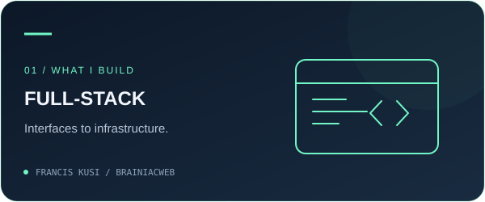
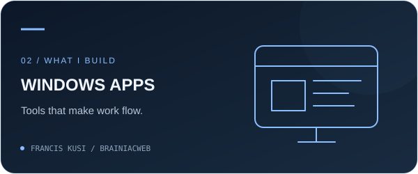
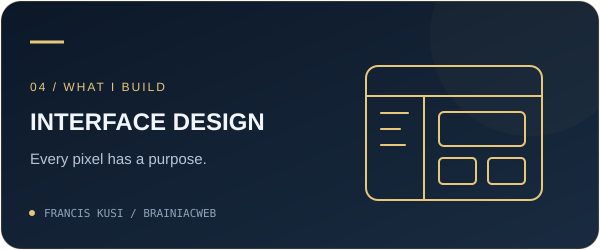

  

  <a href="https://franciskusi.dev"><strong>Portfolio ↗</strong></a>
  &nbsp; · &nbsp;
  <a href="https://www.linkedin.com/in/francis-kusi-1b643a258/"><strong>LinkedIn ↗</strong></a>
  &nbsp; · &nbsp;
  <a href="https://github.com/brainiacweb-tech?tab=repositories"><strong>Explore my work ↗</strong></a>

 

### Hi, I'm Francis 👋

I'm a **full-stack developer, Windows app developer, and AI chatbot builder** based in **Ghana 🇬🇭**, studying Business Information Technology at **KNUST**.

I bring together interface design, application logic, and databases to turn ideas into complete digital products—from web platforms and desktop tools to conversational experiences. My business background shapes the questions I ask: **Who is this for? What problem does it solve? How can it work better?**

I care about thoughtful visuals, clear interactions, and the engineering behind them.

 

### What I design & build

<table>
<tr>
<td width="50%" valign="top">

#### 🌐 Full-stack development
**From the first screen to the database.**

I build web experiences that connect frontend interfaces with backend services, authentication, APIs, and structured data. I enjoy bringing the pieces together into one coherent product.

`Web interfaces` · `APIs` · `Databases`

</td>
<td width="50%" valign="top">

#### 🪟 Windows applications
**Useful software, right on your desktop.**

I develop Windows apps and productivity tools that simplify everyday tasks. My focus spans desktop interfaces, file utilities, and automation, with attention to clear controls and practical workflows.

`Desktop UI` · `Productivity` · `Automation`

</td>
</tr>
<tr>
<td width="50%" valign="top">

#### 🤖 AI chatbots
**Conversation with a purpose.**

I build AI chatbot experiences that help users ask questions, find information, and get things done. I care about how the conversation feels, how the assistant fits into a product, and whether its responses are useful.

`Conversational UI` · `AI integration` · `Assistants`

</td>
<td width="50%" valign="top">

#### 🎨 Interface design
**Clarity in every screen.**

I shape layouts, reusable cards, visual identities, and user flows with attention to typography, spacing, and hierarchy. I enjoy carrying a design through to a working interface.

`UI design` · `Visual identity` · `Interaction`

</td>
</tr>
</table>

 

### Selected builds

<table>
<tr>
<td width="50%" valign="top">

#### 🇬🇭 cedikit
**Local context. Practical Python.**

A toolkit for Ghanaian phone numbers, cedi amounts, and Mobile Money transactions. Clean data, turn payment SMS into ledgers, and flag suspicious payment messages.

`Python` · `Data validation` · `Desktop & API`

**[Explore cedikit ↗](https://github.com/brainiacweb-tech/cedikit)**

</td>
<td width="50%" valign="top">

#### ⚡ Sortify
**Less file chaos. More control.**

A desktop file organizer with dry-run previews, duplicate detection, storage analytics, and undo. Built to make everyday file management easier.

`Python` · `React` · `Flask`

**[Explore Sortify ↗](https://github.com/brainiacweb-tech/sortify)**

</td>
</tr>
</table>

 

### Where business meets code

| Focus | What I'm doing |
| :--- | :--- |
| **Data & decisions** | Power BI dashboards, DAX, SQL, and relational data modeling. |
| **Core toolkit** | Python, FastAPI, SQLAlchemy, SQL, React, and C# across web and Windows projects. |
| **Product thinking** | Building and selling study guides with custom Python and ReportLab pipelines. |
| **Learning next** | Flutter and cross-platform mobile development. |

<strong>A little more about my work ↓</strong>

 

- **Business intelligence:** Built six interactive Power BI dashboards from a retail dataset spanning 10 relational tables.
- **Kairos — Smart Student Planner:** A group project using FastAPI, SQLAlchemy, JWT, and NiceGUI to bring coursework, deadlines, and study sessions together.
- **Document automation:** Built workflows for Word templates, PDF embedding, and PDF conversion to simplify assignment preparation.
- **Database foundations:** Exploring entity relationships, normalization, and SQL as the foundation of dependable applications.

 

### From idea to everyday use

**01 · Discover** &nbsp; Understand the people, the problem, and the business.  
**02 · Design** &nbsp; Map the flow, shape the interface, and model the data.  
**03 · Develop** &nbsp; Connect the frontend, backend, and integrations.  
**04 · Refine** &nbsp; Test the experience, polish the details, and ship.

 

### My approach

> Understand the business. Model the data. Build with care. Ship something useful.

I'm open to **internships, freelance projects, and thoughtful collaborations** in **full-stack development, Windows apps, AI chatbots, interface design, and data**—especially ideas with a connection to the African market.

  <strong>Have an idea worth building?</strong> 
  A web platform. A Windows tool. An AI assistant. A better experience.  
  <a href="https://www.linkedin.com/in/francis-kusi-1b643a258/"><strong>Let's build something useful ↗</strong></a>
  &nbsp; · &nbsp;
  <a href="https://franciskusi.dev"><strong>Visit my portfolio ↗</strong></a>

---

  Built with curiosity. Grounded in Ghana. Open to the world.

