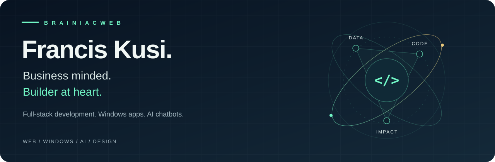

  

  <a href="https://franciskusi.dev"><strong>Portfolio ↗</strong></a>
  &nbsp; · &nbsp;
  <a href="https://www.linkedin.com/in/francis-kusi-1b643a258/"><strong>LinkedIn ↗</strong></a>
  &nbsp; · &nbsp;
  <a href="https://github.com/brainiacweb-tech?tab=repositories"><strong>Explore my work ↗</strong></a>

 

### Hi, I'm Francis 👋

A **Business Information Technology student at KNUST**, database enthusiast, and developer based in **Ghana 🇬🇭**. I build across Python, web, and desktop, explore business intelligence, and am learning Flutter.

I like understanding **why a problem matters** as much as figuring out how to solve it.

 

### Selected builds

<table>
<tr>
<td width="50%" valign="top">

#### 🇬🇭 cedikit
**Local context. Practical Python.**

A toolkit for Ghanaian phone numbers, cedi amounts, and Mobile Money transactions. Clean data, turn payment SMS into ledgers, and flag suspicious payment messages.

`Python` · `Data validation` · `Desktop & API`

**[Explore cedikit ↗](https://github.com/brainiacweb-tech/cedikit)**

</td>
<td width="50%" valign="top">

#### ⚡ Sortify
**Less file chaos. More control.**

A desktop file organizer with dry-run previews, duplicate detection, storage analytics, and undo. Built to make everyday file management easier.

`Python` · `React` · `Flask`

**[Explore Sortify ↗](https://github.com/brainiacweb-tech/sortify)**

</td>
</tr>
</table>

 

### Where business meets code

| Focus | What I'm doing |
| :--- | :--- |
| **Data & decisions** | Power BI dashboards, DAX, SQL, and relational data modeling. |
| **Useful software** | Python applications, FastAPI backends, and workflow automation. |
| **Product thinking** | Building and selling study guides with custom Python and ReportLab pipelines. |
| **Learning next** | Flutter and cross-platform mobile development. |

<strong>A little more about my work ↓</strong>

 

- **Business intelligence:** Built six interactive Power BI dashboards from a retail dataset spanning 10 relational tables.
- **Kairos — Smart Student Planner:** A group project using FastAPI, SQLAlchemy, JWT, and NiceGUI to bring coursework, deadlines, and study sessions together.
- **Document automation:** Built workflows for Word templates, PDF embedding, and PDF conversion to simplify assignment preparation.
- **Database foundations:** Exploring entity relationships, normalization, and SQL as the foundation of dependable applications.

 

### My approach

> Understand the business. Model the data. Build with care. Ship something useful.

I'm open to **internships, freelance projects, and thoughtful collaborations** in data, business intelligence, and software—especially ideas with a connection to the African market.

**[Let's connect on LinkedIn ↗](https://www.linkedin.com/in/francis-kusi-1b643a258/)**

---

  Built with curiosity. Grounded in Ghana. Open to the world.

